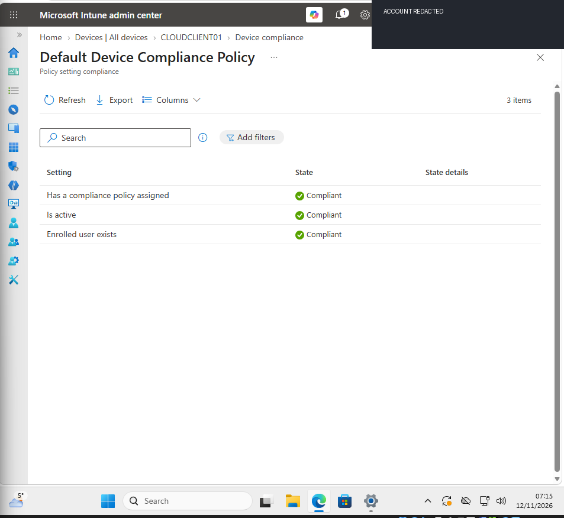
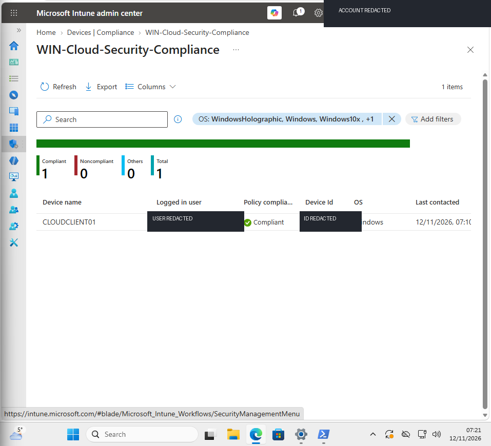
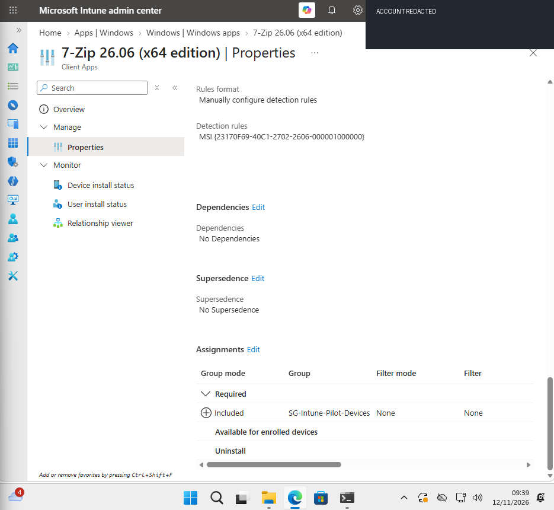
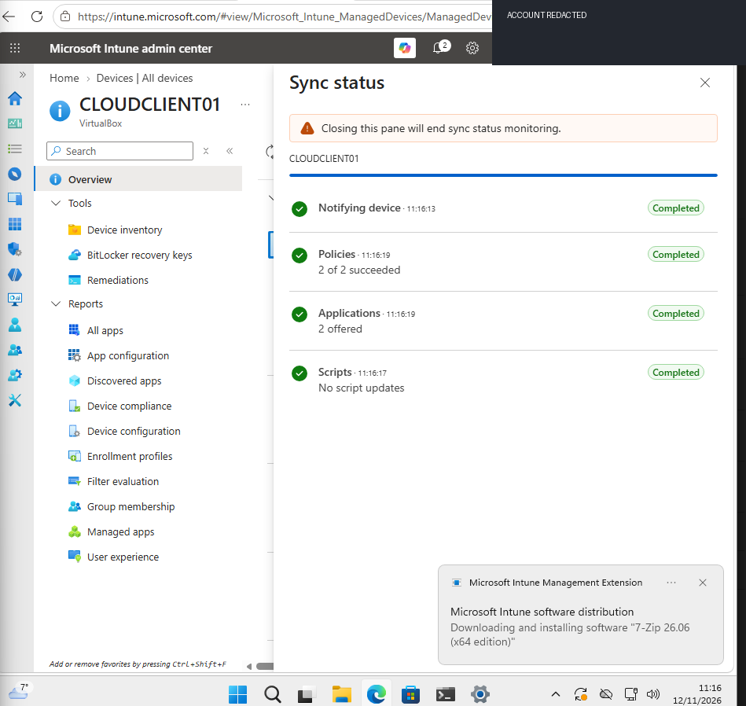
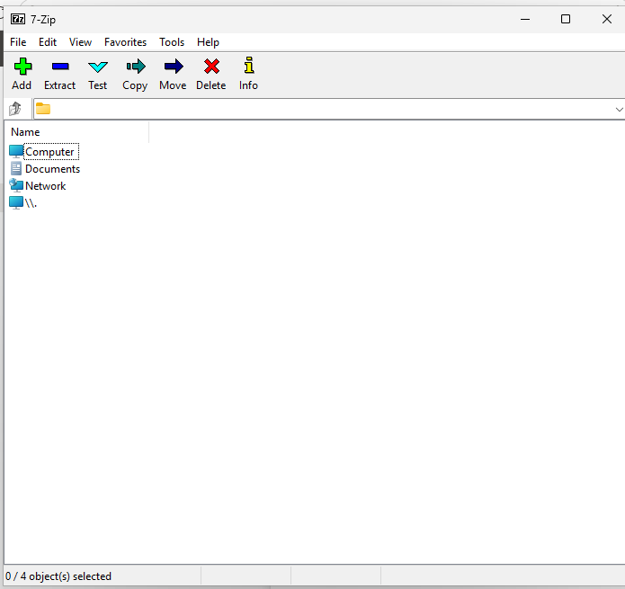
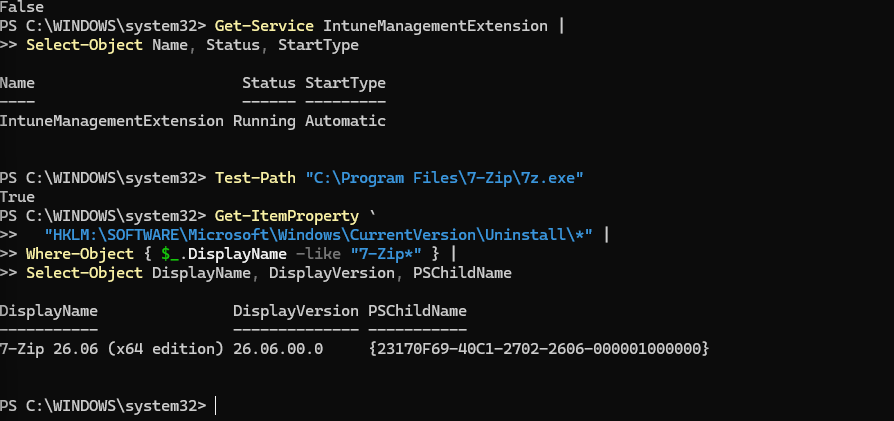
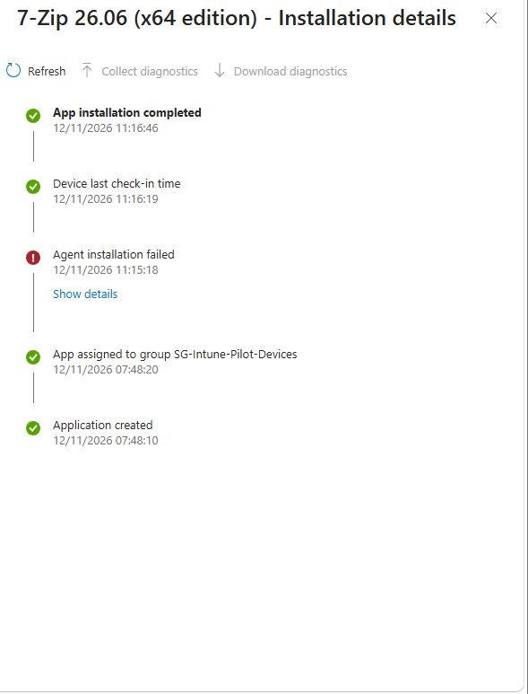

# Cloud IAM and Intune — Redacted evidence

These are **authentic screenshots from the isolated lab**, with the account/profile header obscured using opaque redaction.
The lab tenant's **active email addresses are deliberately omitted**. These screenshots are not recreated mockups. Some were **cropped** to exclude browser/profile areas.

> **Publication note:** This collection was curated for public sharing. Still review every image before committing, especially any account fields, device IDs, tenant IDs, URLs, log messages, and other identifiers.

| Evidence | What it establishes |
|---|---|
| [Intune device compliance checks](01-intune-device-compliance.png) | Intune device compliance checks |
| [WIN-Cloud-Security-Compliance compliant device](02-intune-compliance-policy.png) | WIN-Cloud-Security-Compliance compliant device |
| [Win32 app detection and Required assignment](03-win32-app-assignment.png) | Win32 app detection and Required assignment |
| [Device sync and app offer](04-intune-sync-and-app-offer.png) | Device sync and app offer |
| [7-Zip running on the managed Windows VM](05-7zip-running.png) | 7-Zip running on the managed Windows VM |
| [PowerShell local app and IME verification](06-win32-local-verification.png) | PowerShell local app and IME verification |
| [Intune completed installation timeline](07-win32-installation-completed.png) | Intune completed installation timeline |

## Selected screenshots

### Intune device compliance checks

### WIN-Cloud-Security-Compliance compliant device

### Win32 app detection and Required assignment

### Device sync and app offer

### 7-Zip running on the managed Windows VM

### PowerShell local app and IME verification

### Intune completed installation timeline

## What these images do **not** prove

- An Intune sync message alone does not prove installation; use the local 7-Zip and Intune installation evidence together.
- The uninstall process was practiced, but a separate screenshot of final successful uninstall was not retained here.
- Compliance checks shown here are evidence of the lab configuration, not a production security guarantee.

## Redaction standard

- No active login email addresses, passwords, MFA details, tenant IDs, device IDs, or authentication tokens should appear in public artifacts.
- Use **opaque blocks** to permanently mask identifiers rather than blur or semi-transparent overlays.
- Do not upload unredacted original screenshots, raw management logs, or complete `dsregcmd /status` outputs.