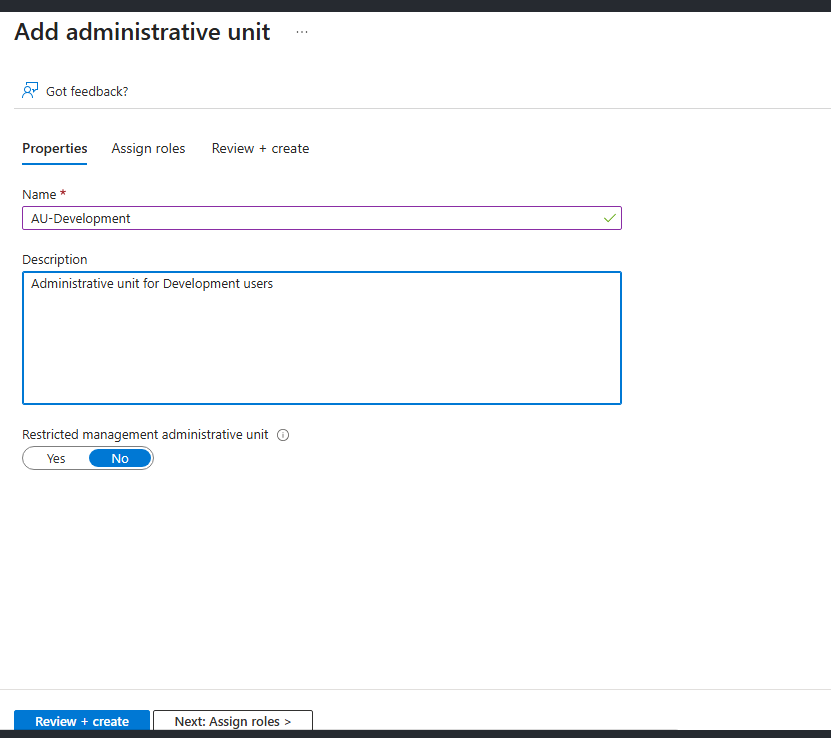
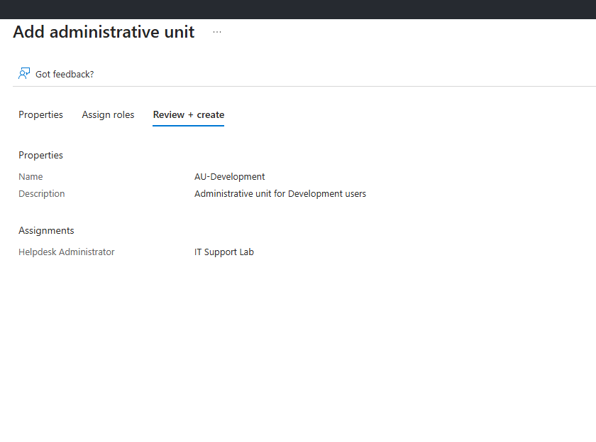
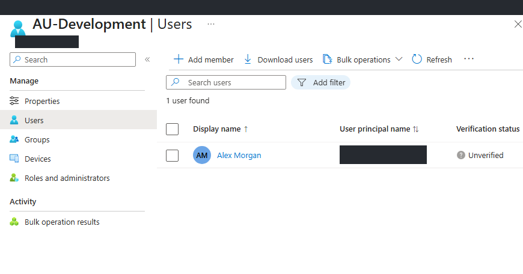
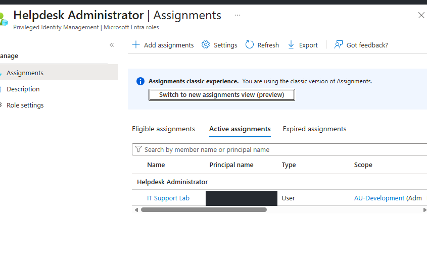
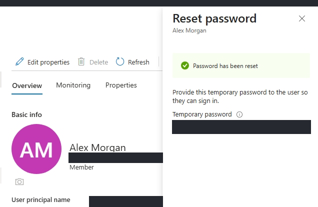
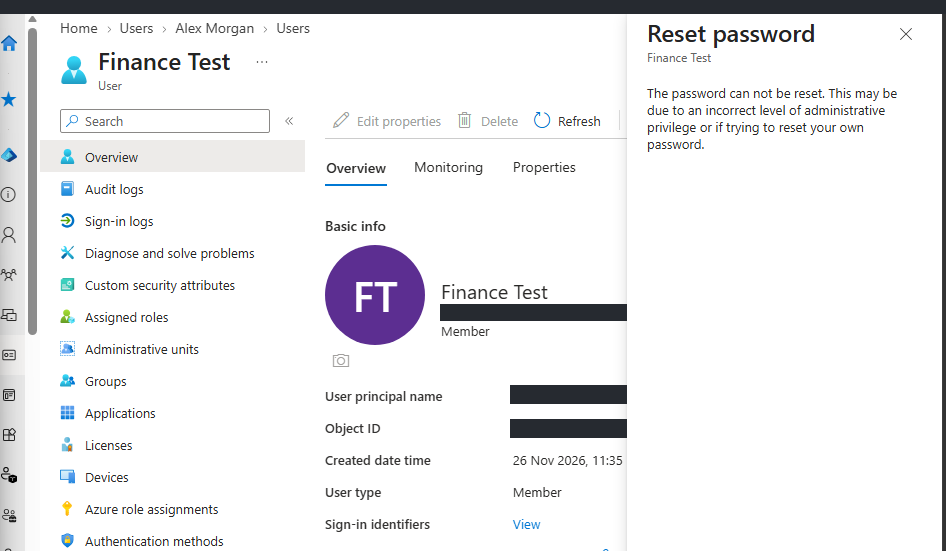
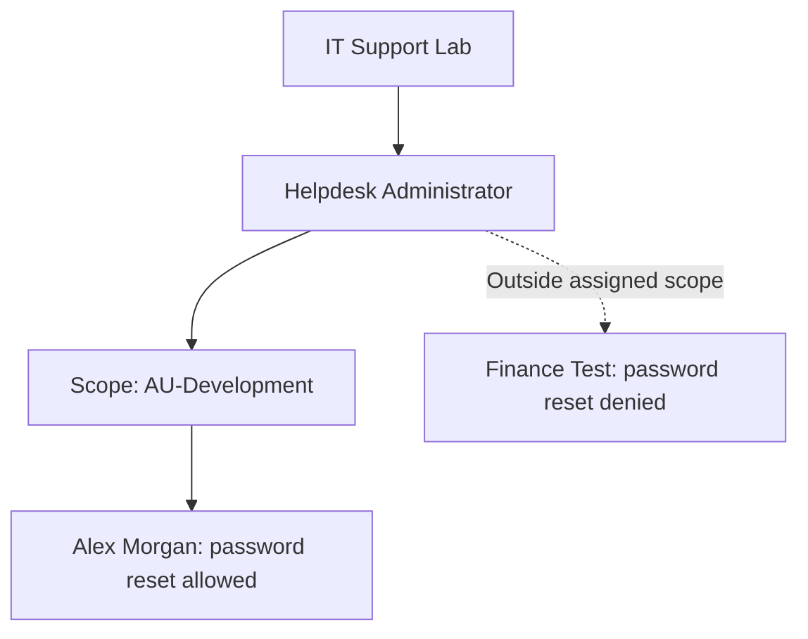
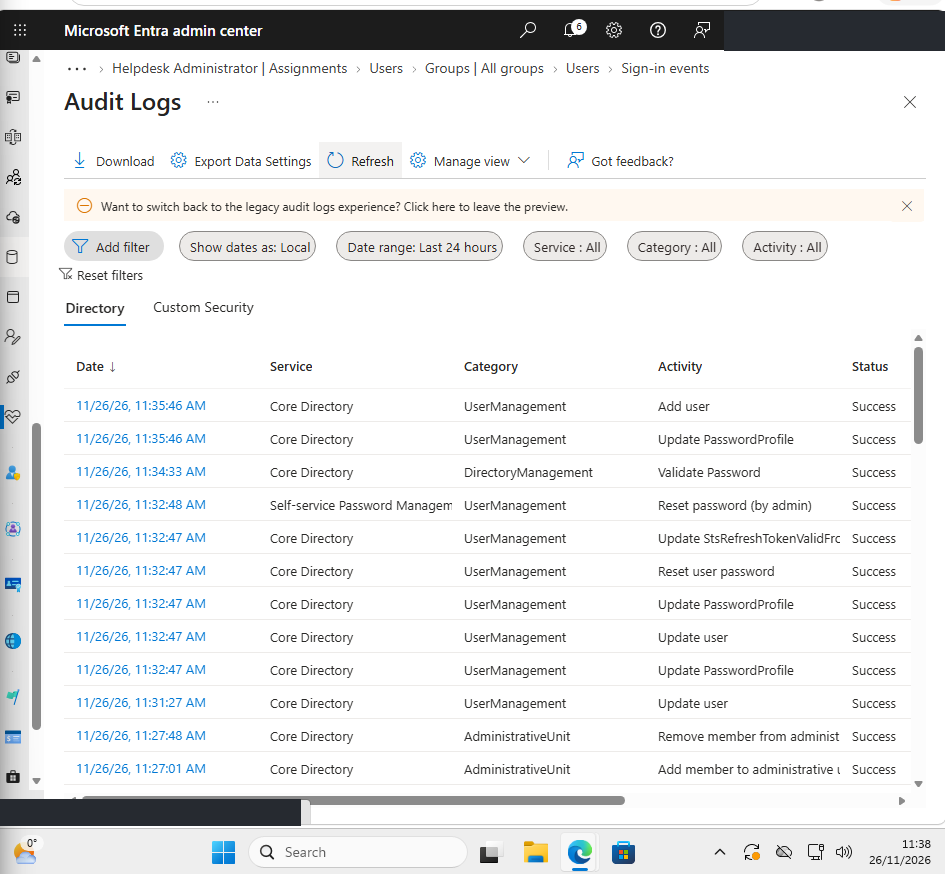

# Lab 20 — Microsoft Entra ID Roles and Administrative Units

**Status:** Practical implementation and permission tests completed  
**Date:** 26 November 2026  
**SC-300 focus:** Implement and manage user identities

## Objective

Implement delegated password reset administration using Microsoft Entra role-based access control (RBAC) and a standard Administrative Unit (AU). Verify that a Helpdesk Administrator can reset a non-administrator user's password within the assigned scope, but cannot reset another ordinary user's password outside that scope.

This lab builds on the existing cloud identities from Lab 19. It was performed in a self-directed training tenant, not a production environment.

## Environment

| Component | Configuration |
| --- | --- |
| Workstation | CLOUDCLIENT01 (Windows 11) |
| Directory | Microsoft Entra ID |
| Administration | Microsoft Entra admin center |
| Licensing | Microsoft Entra ID P2 trial |
| Initial administrator | Global Administrator, directly assigned |
| Delegated administrator | IT Support Lab |
| In-scope test user | Alex Morgan (Development) |
| Out-of-scope test user | Finance Test (Finance) |

Existing identities were reused; Finance Test was created specifically as an ordinary out-of-scope test user. The on-premises domain controller and workstation were not needed for this exercise.

## 1. Create an Administrative Unit

Using the Global Administrator account, I navigated to **Entra ID > Roles & admins > Admin units > Add** and configured:

| Setting | Value |
| --- | --- |
| Name | `AU-Development` |
| Description | Administrative unit for Development users |
| Restricted management administrative unit | No |

I selected a standard AU to scope delegated administrative permissions without applying restricted-management protections.

## 2. Delegate the Helpdesk Administrator role

In the **Assign roles** stage of AU creation, I selected Helpdesk Administrator and assigned the existing IT Support Lab account. I reviewed the settings and created the AU.

| Setting | Value |
| --- | --- |
| Role | Helpdesk Administrator |
| Principal | IT Support Lab |
| Scope | `AU-Development` |
| Assignment state (verified later) | Active |

The user-selection screen is available [here](evidence/02-select-delegated-administrator.png). The review page confirms the intended role and principal before deployment.

## 3. Configure AU membership

I opened **AU-Development > Users > Add member** to populate the AU. The initial membership contained both Alex Morgan and IT Support Lab. I removed IT Support Lab from the AU membership and retained Alex Morgan as the sole member.

- [Initial membership before correction](evidence/04-initial-au-membership.png)

I then verified that IT Support Lab still held the active Helpdesk Administrator role assignment scoped to the AU.

AU membership defines the managed objects; it is separate from the scoped role assignment. A delegated administrator does not need to be an AU member to administer its members.

## 4. Test delegated permissions

I kept the Global Administrator session open and signed in to the Entra admin center as IT Support Lab in a separate InPrivate browser session.

### Positive test — password reset within scope

I opened **Entra ID > Users > Alex Morgan > Reset password**. Entra reported that the password had been reset successfully. The temporary password and account identifiers are redacted in the evidence.

### Negative test — password reset outside scope

Using the Global Administrator session, I created Finance Test as an ordinary user outside `AU-Development`, without assigning an administrative role. I returned to the IT Support Lab session, opened Finance Test and attempted a password reset.

Entra displayed an error indicating that the password could not be reset due to the level of administrative privilege (the message also lists self-reset as a possible cause). Finance Test is a separate account, and the scoped administrator could successfully reset the in-scope user but not the out-of-scope user.

| Test | Expected | Observed |
| --- | --- | --- |
| Reset Alex Morgan's password | Allowed | Success |
| Reset Finance Test's password | Denied | Denied |
| View Finance Test outside the AU | May be allowed | User visible |

The tests demonstrate scoped administration and least privilege. Visibility of a directory object does not imply authorization to modify it. No other administrative actions (for example, role assignments or Conditional Access policy creation) were tested using the delegated account.

## 5. Review the audit trail

Using the Global Administrator session, I navigated to **Entra ID > Monitoring & health > Audit logs**.

The audit log list showed these successful password reset events (timestamps as displayed in the portal):

| Time | Service | Activity | Result |
| --- | --- | --- | --- |
| 11:32:47 AM | Core Directory | Reset user password | Success |
| 11:32:48 AM | Self-service Password Management | Reset password (by admin) | Success |

I also opened the event details and manually confirmed that IT Support Lab reset Alex Morgan's password. The detailed actor-and-target view was not captured in the screenshots supplied for this repository; the attached audit log list corroborates the successful reset activity but does not itself identify the actor or target.

No denied password reset event was observed in the audit logs during the exercise. The portal's denial screenshot is the evidence for the negative test. The reason for the absence of a failure log was not established; the portal may have blocked the operation before a reset request was submitted, or logging may have been delayed.

## 6. Final results

| Validation | Result |
| --- | --- |
| Administrative Unit created | Passed |
| Alex Morgan is the sole AU member | Passed |
| IT Support Lab holds active scoped Helpdesk Administrator role | Passed |
| In-scope password reset | Passed |
| Out-of-scope password reset denied | Passed |
| Successful password reset audit events visible | Passed |
| Actor and target verified in event details | Manually confirmed; detail screenshot not supplied |

At the final observed configuration, AU-Development contained Alex Morgan, IT Support Lab held the scoped active role, and Finance Test remained outside the AU. Removal of the role or deletion of the test user was not performed as part of this lab. The test password reset changed Alex Morgan's credential; restoring or rotating that credential was not verified in the supplied evidence.

## 7. SC-300 lessons learned

- RBAC roles define which administrative actions are permitted; role assignment scope defines which objects those actions apply to.
- An AU is an administrative scoping mechanism, not a security group that grants resource access by itself.
- AU membership and scoped role assignment are independent.
- A scoped Helpdesk Administrator can reset eligible non-administrator users' passwords without Global Administrator privileges.
- Positive and negative permission tests help verify least privilege.
- Audit logs record directory and administrative changes; sign-in logs record authentication activity.

**Practice assessment:** 4/5 (80%) on five lab-specific exam-style questions. The missed question reinforced that a correctly scoped Helpdesk Administrator can reset a non-administrator's password without being a Global Administrator. This is a practice result, not an official Microsoft certification exam score.

## Evidence index

All screenshots are from the actual lab. Opaque redactions remove visible temporary credentials, user principal names, account/tenant details and visible object identifiers where present. Test-user display names, group/AU names, role names and results remain visible to preserve the technical evidence.

| File | Evidence |
| --- | --- |
| [01](evidence/01-administrative-unit-configuration.png) | Standard AU configuration |
| [02](evidence/02-select-delegated-administrator.png) | Available users before selecting the delegated administrator |
| [03](evidence/03-scoped-role-review.png) | Role and principal review before creation |
| [04](evidence/04-initial-au-membership.png) | Initial AU membership before correction |
| [05](evidence/05-final-au-membership.png) | Alex Morgan as sole AU member |
| [06](evidence/06-active-scoped-role-assignment.png) | Active scoped role assignment |
| [07](evidence/07-scoped-password-reset-success.png) | Successful password reset (temporary password redacted) |
| [08](evidence/08-outside-scope-password-reset-denied.png) | Denied password reset outside scope |
| [09](evidence/09-password-reset-audit-log-list.png) | Successful reset events in audit logs |
