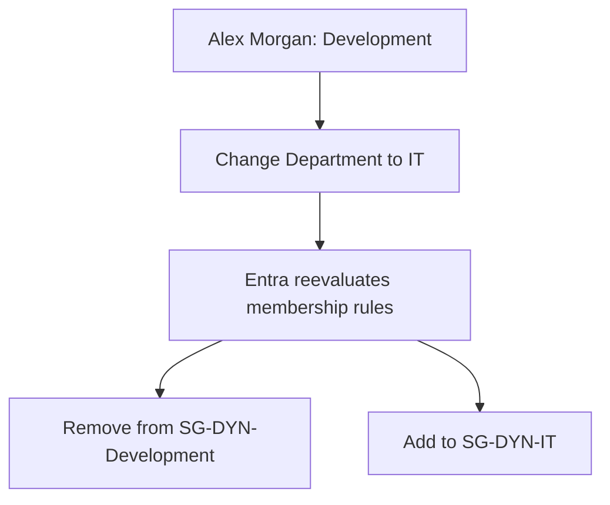

# Lab 19 — Microsoft Entra ID Dynamic Groups

**Status:** Completed and verified in the lab  
**Date:** 26 November 2026  
**SC-300 focus:** Implement and manage user identities

## Objective

Configure and validate dynamic security groups in Microsoft Entra ID, then test automated group membership changes during the Mover stage of the Joiner–Mover–Leaver (JML) identity lifecycle.

This exercise extends my previous Active Directory and PowerShell JML labs with cloud-based, attribute-driven membership management. It is a self-directed training environment, not a production deployment.

## Environment

| Component | Configuration |
| --- | --- |
| Workstation | CLOUDCLIENT01 (Windows 11) |
| Directory | Microsoft Entra ID |
| Administration | Microsoft Entra admin center |
| Licensing | Microsoft Entra ID P2 trial |
| On-premises AD | Separate environment; no directory synchronization used in this lab |

Existing test users and groups were reused where appropriate. The administrator account and existing assigned security groups were left unchanged. The Company name attribute was left empty because it was not needed for the membership rules.

## 1. Review existing identities and groups

| Test user | Job title | Original department |
| --- | --- | --- |
| Alex Morgan | Software Developer | Development |
| IT Support Lab | IT Support Engineer | IT |

The existing `SG-Developers` group was identified as an assigned, cloud-based security group. I retained it and created separate dynamic groups to avoid affecting previous lab configurations.

## 2. Configure dynamic security groups

In the Entra admin center, navigate to **Entra ID > Groups > All groups > New group**.

| Setting | Development group | IT group |
| --- | --- | --- |
| Group name | `SG-DYN-Development` | `SG-DYN-IT` |
| Group type | Security | Security |
| Membership type | Dynamic User | Dynamic User |
| Microsoft Entra roles can be assigned | No | No |

Under **Add dynamic query > Configure Rules**, I configured the following expressions.

**Development:**

```text
(user.department -eq "Development")
```

**IT:**

```text
(user.department -eq "IT")
```

The rules evaluate the user Department attribute using the equality operator (`-eq`). Group membership is managed by Entra rather than through manual user assignments.

## 3. Validate membership rules

Before creating each group, I used **Validate Rules** to check whether the test users met the membership criteria.

| Test user | Development rule | IT rule |
| --- | --- | --- |
| Alex Morgan | Match | No match |
| IT Support Lab | No match | Match |

Both positive and negative tests returned the expected results. After saving the rules and creating the groups, I verified that Alex Morgan was automatically added to the Development group and IT Support Lab to the IT group.

Rule validation confirms eligibility; actual group membership is updated separately by the dynamic membership processing service.

## 4. Simulate an employee department transfer (Mover)

To simulate an internal transfer, I opened **Entra ID > Users > Alex Morgan > Properties > Job information** and changed the Department attribute from `Development` to `IT`.

No manual group membership changes were performed.

After processing completed, I verified the following results in the Members pages:

| Group | Before transfer | After transfer |
| --- | --- | --- |
| `SG-DYN-Development` | Alex Morgan | 0 members |
| `SG-DYN-IT` | IT Support Lab | IT Support Lab, Alex Morgan |



The test demonstrated both automatic addition and removal of dynamic group membership during the Mover stage.

## 5. Restore original configuration and troubleshoot processing delays

I changed Alex Morgan's Department back to `Development` to restore the initial lab state.

The group membership changes were not immediate: Alex temporarily remained in the IT group while the Development group still had zero members.

### Troubleshooting performed

1. Checked that Alex Morgan's Department was correctly saved as `Development`.
2. Inspected the Development group's dynamic rule processing status, which displayed `Succeeded`.
3. Reviewed Entra group audit logs for membership change activity.
4. Allowed additional time for automatic processing without changing the rules, recreating the groups or manually modifying membership.
5. Rechecked both groups and verified that the original membership was restored.

The delay resolved without corrective configuration changes. The observed behavior was consistent with asynchronous membership processing; the exact internal cause and processing duration were not measured.

### Final verified state

| Group | Final membership |
| --- | --- |
| `SG-DYN-Development` | Alex Morgan |
| `SG-DYN-IT` | IT Support Lab |

Both dynamic groups were retained for future SC-300 exercises.

## 6. Test results

| Test | Result |
| --- | --- |
| Development rule validation | Passed |
| IT rule validation | Passed |
| Initial automatic membership | Passed |
| Department transfer from Development to IT | Passed |
| Automatic removal from Development group | Passed |
| Automatic addition to IT group | Passed |
| Restoration of original department | Passed |
| Final membership verification for both groups | Passed |

## 7. Evidence

The following screenshots were captured during the lab. Select a link to view the original evidence (with visible account sign-in identifiers redacted where needed).

| File | Evidence |
| --- | --- |
| [01-dynamic-membership-rule-validation.png](evidence/01-dynamic-membership-rule-validation.png) | Development rule validation |
| [02-dynamic-security-group-configuration.png](evidence/02-dynamic-security-group-configuration.png) | Dynamic security group configuration |
| [03-automatic-group-membership.png](evidence/03-automatic-group-membership.png) | Initial Development membership |
| [04-it-dynamic-rule-validation.png](evidence/04-it-dynamic-rule-validation.png) | IT rule validation |
| [05-it-automatic-group-membership.png](evidence/05-it-automatic-group-membership.png) | Initial IT membership |
| [06-automatic-membership-removal.png](evidence/06-automatic-membership-removal.png) | Development group empty after transfer |
| [07-automatic-membership-reassignment.png](evidence/07-automatic-membership-reassignment.png) | Both users in IT group after transfer |
| [08-restored-dynamic-membership.png](evidence/08-restored-dynamic-membership.png) | Alex restored to Development |
| [09-restored-it-membership.png](evidence/09-restored-it-membership.png) | Only IT Support Lab remains in IT group |
| [10-restored-department-attribute.png](evidence/10-restored-department-attribute.png) | Department restored to Development |
| [11-pending-membership-restoration.png](evidence/11-pending-membership-restoration.png) | Development group still empty during restoration |
| [12-dynamic-rule-processing-status.png](evidence/12-dynamic-rule-processing-status.png) | Processing status displayed Succeeded |
| [13-group-audit-logs.png](evidence/13-group-audit-logs.png) | Group audit events during troubleshooting |

The screenshots retain test user display names, group names, rules and observed results. User principal names in the validation screenshots are covered by opaque redactions; the bottom edge of the group creation screenshot is cropped to remove a partial UI tooltip.

## 8. Key IAM and SC-300 lessons

- Dynamic User membership is based on user attributes; Dynamic Device membership is based on device attributes.
- Microsoft Entra ID P1 is sufficient for dynamic user group licensing; P2 also supports it.
- Dynamic groups cannot be manually populated with individual users, and role-assignable groups require assigned membership.
- Rule validation and membership processing are separate. Changes are asynchronous, not instantaneous.
- Assigned groups are not automatically reevaluated when a user's Department changes. Existing assigned memberships must be reviewed separately.
- Automatic removal of outdated membership supports least privilege and reduces privilege accumulation, but it is not a complete effective-access review.
- In production, attribute accuracy, controlled attribute modification, suitable group ownership and audit monitoring are important for reliable access governance.

## Scope and limitations

This lab verified directory group membership changes, not access to an application or resource. No Conditional Access policy, application assignment or Intune policy was attached to the new groups as part of this exercise. No production identities or systems were used.

## Conclusion

I successfully configured two Microsoft Entra dynamic security groups, validated attribute-based membership rules and demonstrated automatic membership changes during an employee transfer and restoration. I also investigated a membership processing delay using user properties, group status and audit logs without unnecessarily changing a working configuration.

This exercise demonstrates practical cloud identity administration, identity lifecycle management and troubleshooting skills relevant to Microsoft SC-300 preparation.
