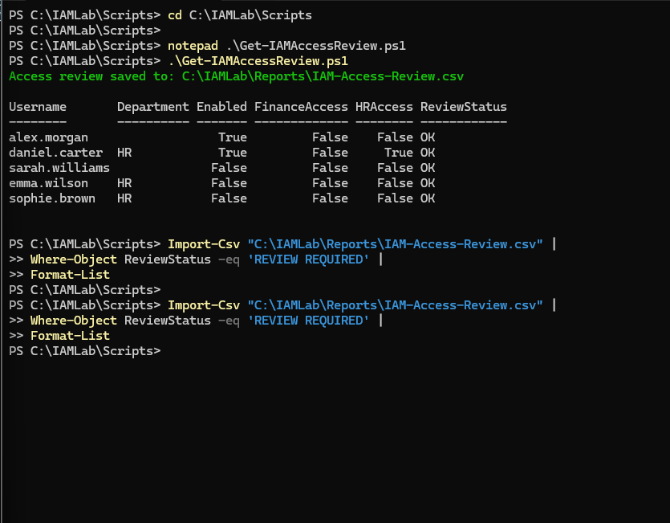
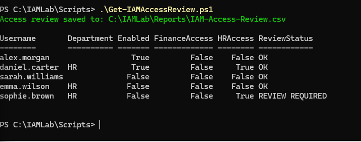
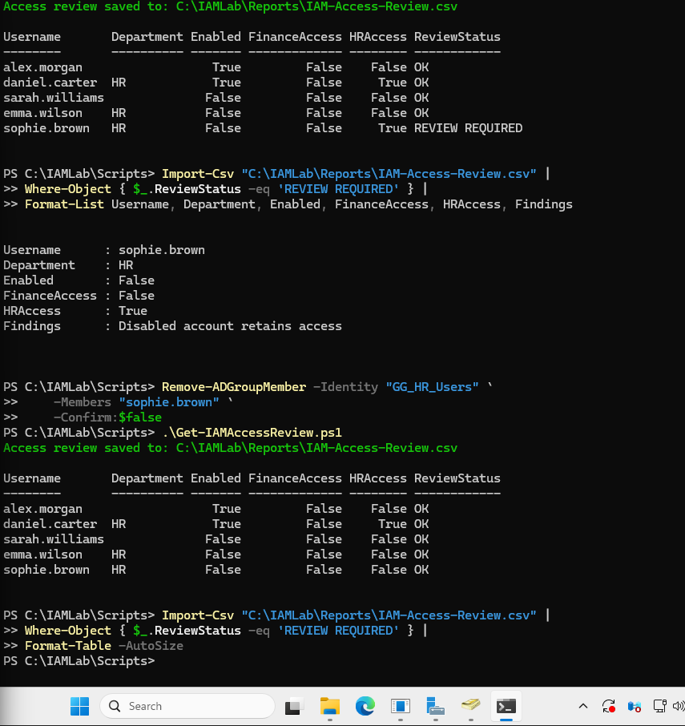
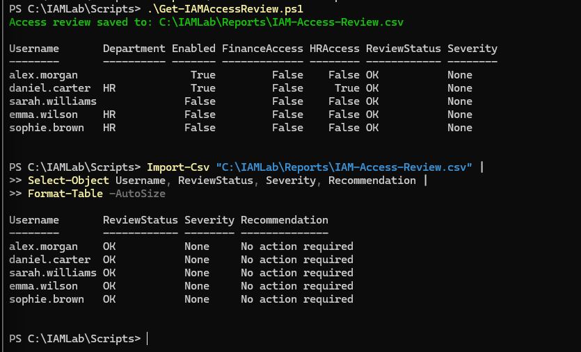

# Lab 19 — Automated Active Directory Access Reviews

**SC-300 identity governance practice · On-premises simulation · Completed 17 November 2026**

> **Environment:** VirtualBox `DC01`, Active Directory domain `corp.sunrock.test`. Employee names and domain are lab examples. This lab is a PowerShell simulation of access certification, **not** Microsoft's native Entra access-review service.

## Objectives

Assess access against employment state and department; identify unauthorized or excessive membership; assign severity; record before/after evidence; remediate only after a reviewer's approval.

## Prerequisites

- Windows Server DC01 with RSAT ActiveDirectory PowerShell module.
- OUs `OU=Employees` and `OU=DisabledUsers`.
- Global groups `GG_Finance_Users` and `GG_HR_Users`.
- Existing tested script `scripts/Get-IAMAccessReview.ps1` in this repository; on DC01 at `C:\IAMLab\Scripts\Get-IAMAccessReview.ps1`.
- Report folder `C:\IAMLab\Reports` and evidence folder `C:\IAMLab\Reports\AccessReviews`.

## Step-by-step procedure

### 1 — Inspect the current group members

Run on DC01 as a lab administrator:

```powershell
Import-Module ActiveDirectory
Get-ADGroupMember -Identity 'GG_Finance_Users' | Select-Object Name, SamAccountName, ObjectClass
Get-ADGroupMember -Identity 'GG_HR_Users' | Select-Object Name, SamAccountName, ObjectClass
```

**Observed:** Finance group had no direct members; HR group contained Daniel Carter. Disabled test users Emma Wilson and Sophie Brown had no departmental entitlements.

### 2 — Generate a read-only baseline

```powershell
Set-Location C:\IAMLab\Scripts
.\Get-IAMAccessReview.ps1
Import-Csv 'C:\IAMLab\Reports\IAM-Access-Review.csv' |
  Where-Object { $_.ReviewStatus -eq 'REVIEW REQUIRED' } |
  Format-List
```

**Observed:** Five user accounts reviewed; zero findings. This does **not** prove all possible permissions are safe—the script examines only specified groups and OUs.



### 3 — Simulate a controlled policy violation

In this **isolated lab only**, temporarily add the *disabled* Sophie Brown account to the HR group:

```powershell
Add-ADGroupMember -Identity 'GG_HR_Users' -Members 'sophie.brown'
.\Get-IAMAccessReview.ps1
Import-Csv 'C:\IAMLab\Reports\IAM-Access-Review.csv' |
  Where-Object { $_.ReviewStatus -eq 'REVIEW REQUIRED' } |
  Format-List Username, Enabled, HRAccess, Findings
```

**Observed:** `sophie.brown` showed `Enabled=False`, `HRAccess=True`, `REVIEW REQUIRED`, finding `Disabled account retains access`. A disabled account's group membership is an inappropriate retained **entitlement**, not proof of a successful sign-in.



### 4 — Remediate and independently verify

```powershell
Remove-ADGroupMember -Identity 'GG_HR_Users' -Members 'sophie.brown' -Confirm:$false
.\Get-IAMAccessReview.ps1
Import-Csv 'C:\IAMLab\Reports\IAM-Access-Review.csv' |
  Where-Object { $_.ReviewStatus -eq 'REVIEW REQUIRED' }
```

**Observed:** All five records returned `OK`; the findings query produced no records.



### 5 — Preserve review evidence

```powershell
New-Item 'C:\IAMLab\Reports\AccessReviews' -ItemType Directory -Force
Copy-Item 'C:\IAMLab\Reports\IAM-Access-Review.csv' 'C:\IAMLab\Reports\AccessReviews\IAM-010-After.csv'
```

A separate manual remediation CSV was created for `IAM-010`. The earlier before-state was captured in terminal evidence; the main CSV is overwritten after every run, so **do not claim the original before-state CSV was preserved for IAM-010**.

### 6 — Enhance classification and test severity

The updated script added `Severity` and `Recommendation`, classifying disabled accounts retaining access, access mismatches, dual-department membership, and enabled accounts in the disabled OU as **High** risk. Missing expected access is **Medium**.

```powershell
.\Get-IAMAccessReview.ps1
Import-Csv 'C:\IAMLab\Reports\IAM-Access-Review.csv' |
  Select-Object Username, ReviewStatus, Severity, Recommendation |
  Format-Table -AutoSize
```

The clean baseline showed `Severity=None` and `No action required` for all five records.



The high-risk scenario was repeated (`IAM-011`) and before/after CSVs were saved as `IAM-011-Before.csv` and `IAM-011-After.csv`, according to the completed lab steps. The source screenshot retained in this pack is the severity baseline, **not** a screenshot of the High-severity result.

## Security notes

- No automatic entitlement revocation occurs in the review script; remediation was a separate administrative command.
- Direct `MemberOf` checks do not exhaustively enumerate nested effective security access, share ACLs or resource-level permissions.
- The code currently does not flag all users with missing department attributes; that is an improvement opportunity.
- Preserve immutable/centralized logs in production; CSVs are editable and this is a lab demonstration.

## Outcome

**Verified:** Baseline review, intentional violation detection, group removal, clean follow-up review, enhanced severity output, and remediation documentation.
