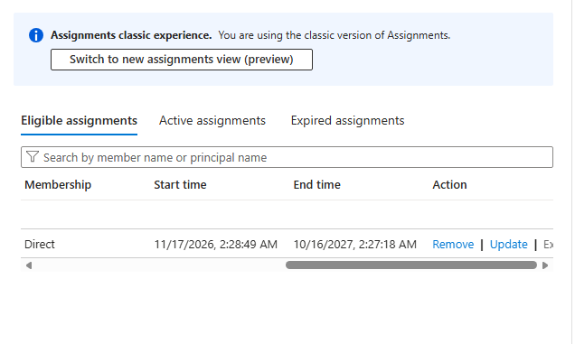
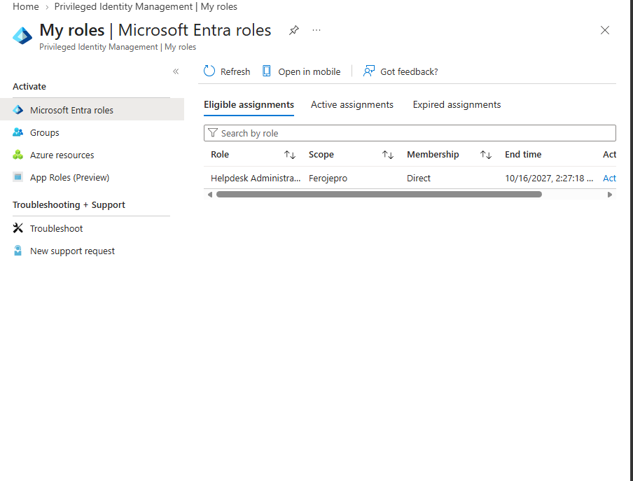
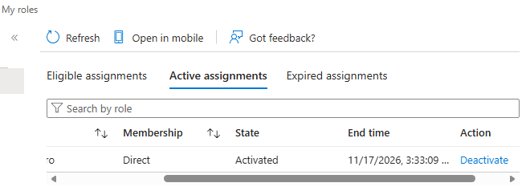
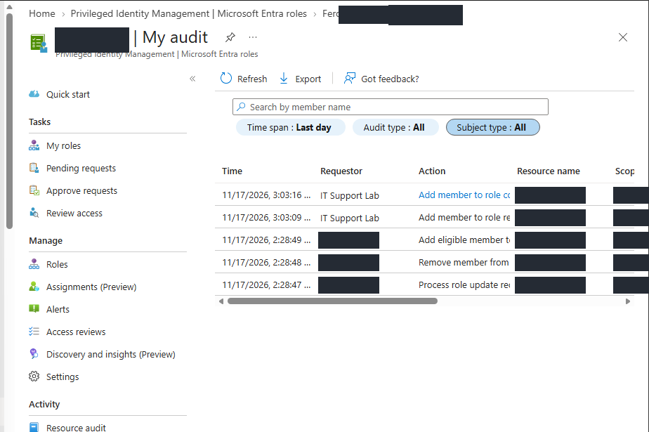
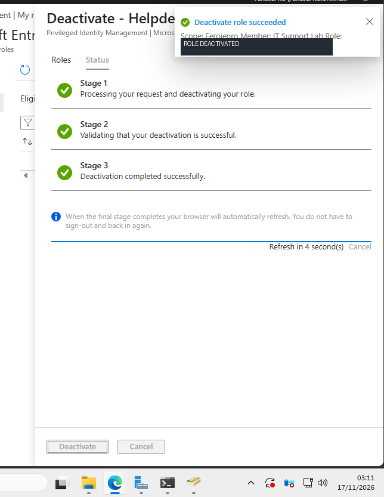

# Lab 21 — Microsoft Entra PIM: Just-in-Time Helpdesk Administrator

**SC-300 privileged access practice · Microsoft Entra ID P2 trial · Completed 17 November 2026**

> Lab tenant is distinct from the on-premises AD domain (no Microsoft Entra Connect sync). **Active account email addresses, tenant identifiers and object IDs are intentionally omitted** from this documentation.

## Objectives

Convert a directly assigned **permanent active** Helpdesk Administrator role into an **eligible** assignment, test temporary activation, inspect the personal PIM audit, then deactivate the role while preserving eligibility.

## Prerequisites

- Microsoft Entra ID P2 trial assigned to the relevant lab users, including `IT Support Lab`.
- An existing tenant administrator with appropriate permissions to manage PIM.
- An independent administrator account retained throughout the exercise; **do not** remove Global Administrator assignments to test this lab.
- Trial expiration shown in the subscription portal: **17 December 2026**, with recurring billing off at the time of the exercise.

## Step-by-step procedure

### 1 — Examine the pre-existing role

On DC01, sign in to `https://entra.microsoft.com` with the main tenant administrator. Go to **ID Governance → Privileged Identity Management → Microsoft Entra roles → Roles → Helpdesk Administrator → Assignments**.

**Observed before:** `IT Support Lab` had **Direct**, **Assigned**, **Permanent** active access; no eligible assignment appeared.

### 2 — Convert the assignment to eligible

Open the active assignment's membership settings. Set **Assignment type: Eligible**; save. Verify **Eligible assignments** shows the lab identity and **Active assignments** no longer contains its permanent assignment.

**Observed:** Direct eligible assignment created. The portal displayed an eligible end date of **16 October 2027**, beyond the P2 trial expiration; the assignment date does not extend trial licensing.

### 3 — Sign in as the eligible user

Use a separate InPrivate session for the test user. In the Entra admin center, open **PIM → My roles → Microsoft Entra roles → Eligible assignments** and locate **Helpdesk Administrator → Activate**.

### 4 — Activate the role

Start activation and follow any tenant requirements for duration, justification, or MFA. The role subsequently appeared under **Active assignments** with **State: Activated** and **Deactivate** available.

**Evidence limitation:** The source screenshot verifies activation, but does not independently establish which MFA, justification or approval requirements were enforced. Do not claim those were verified without separate audit/configuration evidence.

### 5 — Inspect the personal audit history

In **PIM → Microsoft Entra roles**, open **My audit**. **Resource audit** originally showed `No access` from the test-user session, so the personal audit view was used instead.

**Observed:** Role conversion and the later user activation generated audit entries. The shown log contains an activation request and a completion entry, with truncated activity labels.

### 6 — Deactivate and verify

From **My roles → Active assignments**, select **Deactivate**. The portal displayed all three successful stages including **Deactivation completed successfully**. The eligible entry remained available for future time-limited activation.

## Security and SC-300 lessons

- **Eligible ≠ Active:** eligibility permits an activation request but is not continuous privileged authority.
- PIM eligibility duration and each activated session's duration are separate concepts.
- Keep protected administrative access available while modifying privileged roles.
- Review privileges and PIM audit records; avoid granting extra audit/administrator roles merely to view logs.
- P2 is a trial feature here, not a permanent licensed entitlement.

## Outcome

**Verified:** Direct active-to-eligible conversion; successful JIT activation; personal audit events; successful manual deactivation; eligibility preserved.
