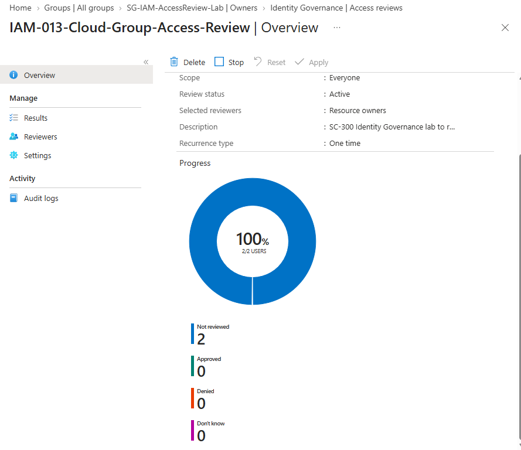
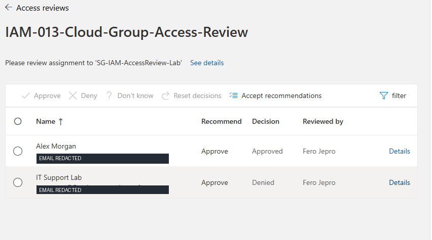
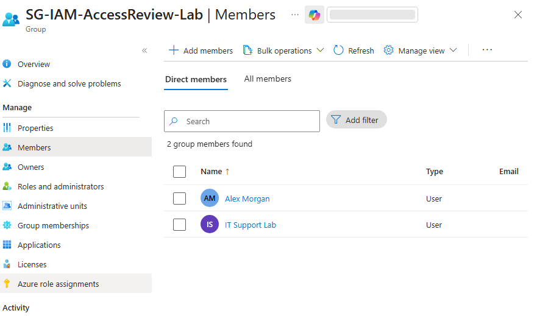
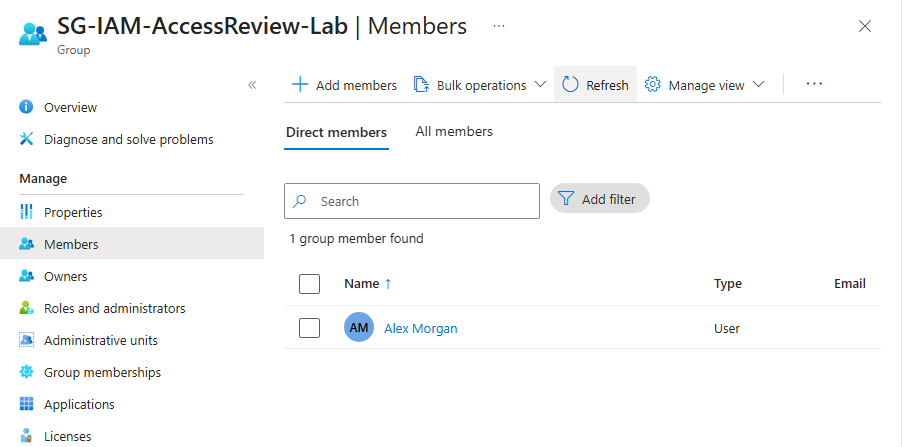
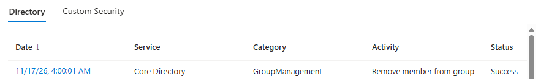
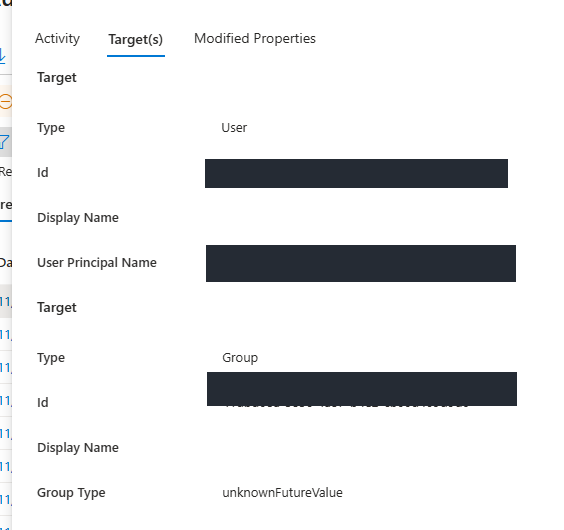

# Lab 22 — Microsoft Entra Access Reviews: Decision to Remediation

**SC-300 identity governance practice · Microsoft Entra ID P2 trial · Started 17 November 2026**

> Screenshots are redacted for public GitHub. The cloud account UPNs remain active and must not appear in repository content.

## Objective

Use Microsoft's native Access Reviews to certify access to a **dedicated security group**. Record one Approve and one Deny decision, **without auto-applying results**, then manually remove the denied membership and verify a successful Microsoft Entra directory audit event.

## Lab configuration

| Field | Value |
|---|---|
| Review | `IAM-013-Cloud-Group-Access-Review` |
| Group | `SG-IAM-AccessReview-Lab` |
| Membership | Assigned; two fictional internal lab users |
| Reviewer | Group owner (main tenant administrator) |
| Scope | **Everyone** (not Guest users) |
| Recurrence | One time |
| Dates | 17–20 November 2026 |
| Automatic application | **Disabled** |
| Nonresponse | No change |
| Justification | Required |

## Step-by-step procedure

### 1 — Create an isolated cloud security group

On DC01, open `https://entra.microsoft.com`, then **Entra ID → Groups → All groups → New group**. Create a cloud **Security** group, **Assigned** membership, named `SG-IAM-AccessReview-Lab`. Set the main tenant administrator as its owner and add **Alex Morgan** and **IT Support Lab** as its two members.

Do **not** use production groups or the existing Intune pilot groups for this exercise.

### 2 — Create a resource access review

Open **ID Governance → Access reviews → New access review → Resource review**. Select **Teams + Groups**, choose the dedicated group and ensure **Review scope: Everyone**. The first attempt to configure the review displayed a **Guest users** scope; this was corrected *before* creation.

Configure **Group owner(s)** as reviewers, **One time** recurrence, **3 days** duration, **Auto apply results: Off**, **No change** for nonresponse, and **Justification required: On**.

Enter the review name `IAM-013-Cloud-Group-Access-Review` and create it. The review creation audit event showed **Success**.

### 3 — Verify startup

The review transitioned from **Not started → Initializing → Active**. The Entra overview showed both internal users included. The initial progress graph at 100% represented the population counted, **not completed decisions**; both decisions were initially `Not reviewed`.

### 4 — Complete certification decisions

Sign in to `https://myaccess.microsoft.com` with the group owner. Under **Access reviews**, open `IAM-013-Cloud-Group-Access-Review` and submit decisions:

| Reviewed member | Decision | Lab business justification |
|---|---|---|
| Alex Morgan | **Approve** | Continued membership required for ongoing IAM training |
| IT Support Lab | **Deny** | Membership no longer required for this dedicated test group |

**Observed:** Both actions were saved and shown in the **Decision** column. Microsoft's **Recommended action: Approve** for both users was advisory and did not determine the final decision.

### 5 — Verify auto-apply is off

Open the group's **Members** page after the review decisions. Both users were still present, which confirmed that **Deny ≠ automatic access revocation** in this configuration.

### 6 — Manually remediate the denied membership

As the authorized group administrator, remove only **IT Support Lab** from `SG-IAM-AccessReview-Lab`. Refresh membership.

**Observed:** Only **Alex Morgan** remained; member count changed from two to one. This did not disable IT Support Lab, revoke its P2 license, or remove its separate PIM eligibility.

### 7 — Verify audit trail

Open **Entra ID → Monitoring & health → Audit logs**, filter for **Remove member from group**. A **Core Directory / GroupManagement** event dated **17 November 2026** showed **Success**.

Inspecting **Target(s)** associated the event with the removed user and the lab group. Identifiers and active UPNs are redacted in the evidence. The screenshots in this pack do not verify the `Initiated by` field; attribution would require a screenshot of that detail.

## Key lessons and limitations

- A **recommended action** is informational; a **reviewer decision** is a separate submitted action.
- A **denied** decision does not automatically revoke access when **auto-apply is disabled**.
- A group owner can review access to their owned group; check the review's configured reviewer and membership before starting.
- Date/time values shown in portal screenshots may use local or tenant display conventions; this guide records displayed dates only.
- The access review remained scheduled through 20 November 2026 when captured; **do not claim the review period had ended**.
- Do not link guest-governance Azure billing merely to complete this internal-member exercise.

## Outcome

**Verified:** Review creation, all-user scope, two saved decisions (one approved and one denied), membership unchanged immediately after decisions, manual removal of denied access, one remaining member, successful directory audit event with matching targets.
